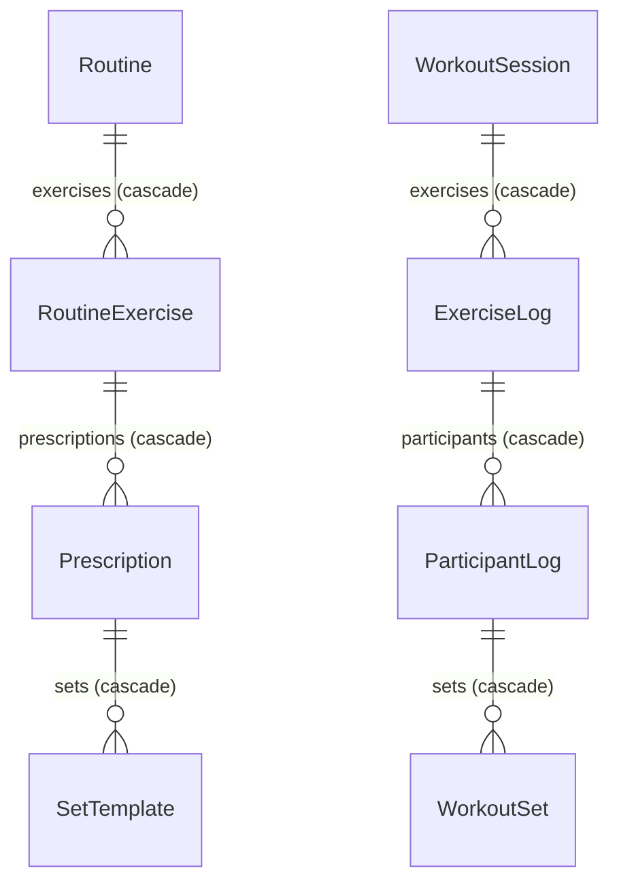
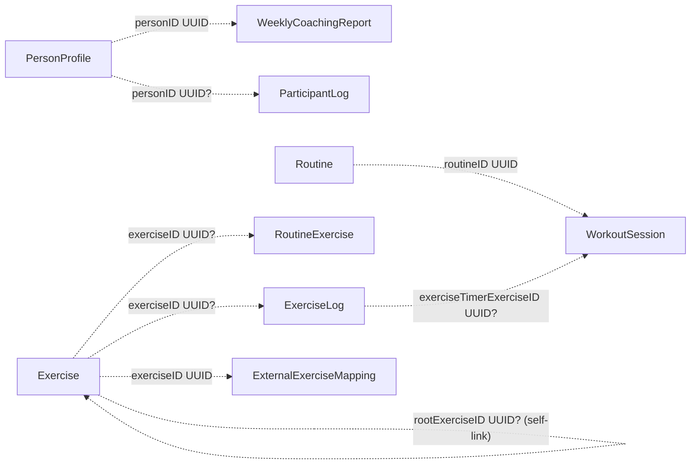

# StrengthLog data model

This guide describes the persisted model as it is declared in `StrengthLog/Models.swift` and registered by `StrengthLogApp`. It is a schema-level view of the app, including model field types, optionality, ownership, logical references, and declared indexes. SwiftData manages the SQLite representation; the tables below describe the Swift model contract, not undocumented physical SQLite column names or storage encodings.

## Storage boundary

The app registers twelve `@Model` types in one SwiftData `Schema`: `PersonProfile`, `WeeklyCoachingReport`, `Exercise`, `Routine`, `RoutineExercise`, `Prescription`, `SetTemplate`, `WorkoutSession`, `ExerciseLog`, `ParticipantLog`, `WorkoutSet`, and `ExternalExerciseMapping`. The normal configuration uses the local SwiftData store, with CloudKit disabled and no App Group container. Tests and Debug fixtures may use isolated in-memory or temporary stores; those are not the normal user store.

SwiftData gives each model a persistent identity. The additional `id: UUID` properties shown below are app-level identifiers used for matching and interchange; the source does not declare them with `@Attribute(.unique)`. Do not assume the app-level `id` field has a uniqueness constraint unless code enforces it.

The storage types used below are Swift types: `UUID`, `String`, `Bool`, `Int`, `Double`, and `Date`. A trailing `?` means nullable/optional. `String?` and optional scalars can be absent. `Routine.participantNames` is a `[String]` transformable collection. Enum-like values are persisted as raw `String` fields, not Swift enum columns. Computed properties and `@Transient` caches are not persisted columns.

## Relationship diagrams

Solid arrows are declared SwiftData object relationships and show the parent-to-children direction plus the delete rule. Dashed arrows are scalar UUID references interpreted by app code; they are not `@Relationship` foreign keys and SwiftData does not enforce referential integrity for them.

Each workout owns a snapshot of its exercises, participants, and sets. Editing a routine does not rewrite a saved workout snapshot. Deleting a routine's child entry cascades through its prescriptions and set templates; deleting a session cascades through its exercise logs, participant logs, and sets.

These logical references can be missing, stale, or orphaned unless the relevant operation checks them. In particular, `routineID`, `personID`, `exerciseID`, `rootExerciseID`, and `exerciseTimerExerciseID` are stored scalar values. The app resolves them with fetches or in-memory matching and has legacy name-based fallbacks in selected paths. Deleting or renaming the referenced record does not get database-enforced cascade or `ON DELETE` behavior through these scalar fields.

## Persisted models

`id` is included in every model even where a relationship field also points at the record. `id` values are created as UUIDs by initializers. “Default” describes the declaration or initializer behavior in the current code; it does not imply a SQL `DEFAULT` constraint in the private SwiftData store.

### `PersonProfile`

| Field | Type | Meaning |
| --- | --- | --- |
| `id` | `UUID` | App-level profile identity. |
| `name` | `String` | Display name; legacy participant matching may use a case-insensitive name when no ID is available. |
| `colorHex` | `String` | Profile color encoded as text. |
| `isArchived` | `Bool` | Whether the profile is archived. |
| `sortOrder` | `Int` | Profile display/onboarding order; initializer default `0`. |

### `WeeklyCoachingReport`

Saved, regenerable summary data. Workout history remains authoritative.

| Field | Type | Meaning |
| --- | --- | --- |
| `id` | `UUID` | Report identity. |
| `personID` | `UUID` | Logical reference to `PersonProfile.id`; no SwiftData relationship. |
| `weekStart`, `weekEnd`, `createdAt` | `Date` | Report week bounds and creation time (`createdAt` defaults to now). |
| `workoutCount`, `completedSetCount`, `schemaVersion` | `Int` | Saved counts and structured-report schema version (`schemaVersion` defaults to `1`). |
| `poundsVolume` | `Double` | Saved pounds × reps volume. |
| `narrative`, `factsJSON`, `structuredCoachingJSON` | `String?` | Optional narrative and serialized report payloads. |
| `provider`, `modelName`, `inputFingerprint` | `String` | Generator/provider metadata and source-input fingerprint. Defaults: `deterministic`, empty, empty. |

The JSON fields are opaque payload strings to SwiftData, not normalized child tables.

### `Exercise`

Catalog and custom exercise master record. Immutable catalog seed data starts in the bundled JSON catalog; user-editable exercise records are persisted here.

| Field | Type | Meaning |
| --- | --- | --- |
| `id` | `UUID` | Exercise record identity. |
| `sourceID` | `String?` | Optional bundled catalog source key. |
| `originalName` | `String` | Canonical/original name; declaration default empty for legacy migration. |
| `rootExerciseID` | `UUID?` | Logical self-reference to the original exercise for duplicates. Initializer sets it to this record's ID when omitted. |
| `name`, `category`, `equipment`, `primaryMuscle` | `String` | Editable display/classification metadata. |
| `unitRaw` | `String` | Raw `TrackingUnit` value; computed `unit` falls back to pounds for unrecognized strings. |
| `repCountingModeRaw` | `String?` | Raw `RepCountingMode` (`standard` or `perSide`); nil reads as standard. |
| `dumbbellLoadReminderEnabled`, `sideTotalRepsReminderEnabled` | `Bool?` | Optional per-exercise overrides; nil defers to equipment/catalog-derived defaults. |
| `sideTotalRepsReminderShowsTotal` | `Bool?` | Saved active-workout callout display choice; nil defaults to showing total reps. Shared by every routine using this exercise. |
| `note` | `String?` | Optional user note. |
| `instructions` | `String` | Exercise instructions. |
| `imagePath` | `String?` | Optional primary bundled image path. |
| `additionalImagePathsRaw` | `String?` | Optional newline-separated image paths (computed API presents them as an array). |
| `isCustom` | `Bool` | Whether user-created rather than a catalog record. |
| `deletedAt` | `Date?` | Soft-delete timestamp; nil means not deleted. |

Computed values such as `canonicalID`, `unit`, `repCountingMode`, `imagePaths`, reminder defaults, and target labels are not extra persisted fields.

### `Routine`

Saved editable program. A routine has ordered exercise entries and legacy participant-name data, but no owned workout weights or set prescriptions in current workflows.

| Field | Type | Meaning |
| --- | --- | --- |
| `id` | `UUID` | Routine identity. |
| `externalID`, `notes` | `String?` | Optional imported identity and notes. |
| `name`, `symbol`, `colorHex` | `String` | Routine display metadata. |
| `sortOrder` | `Int` | Routine ordering; default `0`. |
| `restDurationSeconds` | `Int?` | Optional shared rest timer duration; nil/zero disables it. |
| `createdAt` | `Date` | Creation time, initialized to now. |
| `deletedAt` | `Date?` | Soft deletion; nil means visible/active. |
| `participantNames` | `[String]` | Stored legacy/configuration participant names; defaults to empty. |
| `exercises` | `[RoutineExercise]` relationship | Child entries; delete rule `.cascade`. |

`visibleExercises` and `configuredParticipantNames` are computed and not persisted separately.

### `RoutineExercise`

Ordered membership/notes for an exercise in one routine. It is a separate object so routine-specific ordering, visibility, and supersets do not mutate the exercise master or session history.

| Field | Type | Meaning |
| --- | --- | --- |
| `id` | `UUID` | Entry identity. |
| `exerciseID` | `UUID?` | Logical reference to `Exercise.id`; nil supports legacy name-only entries. |
| `exerciseName` | `String` | Name snapshot/fallback. |
| `notes`, `supersetID` | `String?` | Optional entry notes and superset grouping key. |
| `isHidden` | `Bool?` | Optional visibility flag; nil reads as false. |
| `unitRaw` | `String` | Legacy cached unit retained for store compatibility; current display resolves the master exercise where possible. |
| `sortOrder` | `Int` | Position in the routine. |
| `prescriptions` | `[Prescription]` relationship | Legacy saved prescription children; delete rule `.cascade`. New routines leave these empty. |

### `Prescription`

Legacy routine defaults grouped by participant.

| Field | Type | Meaning |
| --- | --- | --- |
| `id` | `UUID` | Prescription identity. |
| `participantName` | `String` | Participant name this template belongs to. |
| `measurement` | `Double` | Default measurement/load. |
| `sets` | `[SetTemplate]` relationship | Child set targets; delete rule `.cascade`. |

### `SetTemplate`

Legacy set target nested under a prescription.

| Field | Type | Meaning |
| --- | --- | --- |
| `id` | `UUID` | Template identity. |
| `sortOrder` | `Int` | Set ordering. |
| `reps` | `Int` | Target reps (also carries the target slot for legacy values). |

### `WorkoutSession`

One workout occurrence, including active-workout state and the selected participant names.

| Field | Type | Meaning |
| --- | --- | --- |
| `id` | `UUID` | Session identity and external import key component. |
| `externalID`, `notes` | `String?` | Optional source identity and session notes. |
| `routineID` | `UUID` | Logical reference to `Routine.id`; app uses it to resolve the current routine/name. It is not a relationship. |
| `routineName` | `String` | Legacy cached name, normally empty in newly created sessions. |
| `startedAt` | `Date` | Start timestamp; defaults to now. |
| `endedAt` | `Date?` | Optional end timestamp. |
| `isActive` | `Bool` | Whether the workout is open. |
| `restTimerStartedAt`, `restTimerDurationSeconds` | `Date?`, `Int?` | Optional rest timer state. |
| `exerciseTimerStartedAt`, `exerciseTimerDurationSeconds` | `Date?`, `Int?` | Optional exercise countdown start and duration in seconds. |
| `exerciseTimerExerciseID` | `UUID?` | Logical reference to an `ExerciseLog.id` in this session. |
| `deletedAt` | `Date?` | Recoverable deletion timestamp; expired deleted sessions are eventually purged. |
| `participantNames` | `[String]` | Active participant name snapshot for this session. |
| `exercises` | `[ExerciseLog]` relationship | Exercise snapshots; delete rule `.cascade`. |

Computed counts, duration, and timer end dates are derived from these fields and child rows.

### `ExerciseLog`

One exercise snapshot inside a session.

| Field | Type | Meaning |
| --- | --- | --- |
| `id` | `UUID` | Session-exercise identity. |
| `exerciseID` | `UUID?` | Logical link to the master `Exercise.id`; nil supports legacy name-only history. |
| `exerciseName` | `String` | Name snapshot shown in history even if the master is renamed or missing. |
| `notes`, `supersetID` | `String?` | Optional session-specific notes/grouping. |
| `unitRaw` | `String` | Legacy/orphan fallback unit; normally resolved from the current master. |
| `sortOrder` | `Int` | Position in this workout. |
| `isBilateral` | `Bool` | Whether the exercise is tracked across both sides; defaults false. |
| `dumbbellArmCount` | `Int?` | Legacy migration field, not used by current callout UI. |
| `participants` | `[ParticipantLog]` relationship | Per-person logs; delete rule `.cascade`. |

The cached master exercise is marked `@Transient`, so it is not persisted.

### `ParticipantLog`

One person's values and sets for one exercise log.

| Field | Type | Meaning |
| --- | --- | --- |
| `id` | `UUID` | Participant-log identity. |
| `participantName` | `String` | Name snapshot, including legacy cases without a profile. |
| `personID` | `UUID?` | Logical link to `PersonProfile.id`; nil for legacy or ambiguous matches. |
| `measurement` | `Double` | Participant-level default load/measurement used when a set has no override. |
| `sets` | `[WorkoutSet]` relationship | Recorded/target sets; delete rule `.cascade`. |

### `WorkoutSet`

One set target/result. Reps are retained for compatibility even when another measure such as seconds or distance is populated.

| Field | Type | Meaning |
| --- | --- | --- |
| `id` | `UUID` | Set identity. |
| `sortOrder`, `reps` | `Int` | Position and rep/target value. |
| `isCompleted` | `Bool` | Overall completion. |
| `completedAt` | `Date?` | Optional completion timestamp. |
| `isSkipped` | `Bool` | Whether the set was skipped; defaults false. |
| `measurement`, `distanceMiles`, `durationSeconds`, `rpe` | `Double?` | Optional per-set load, canonical miles, duration in seconds, and RPE. |
| `setTypeRaw` | `String?` | Optional imported/source set type. |
| `leftReps`, `rightReps` | `Int?` | Optional per-side rep values. |
| `isLeftCompleted`, `isRightCompleted` | `Bool` | Per-side completion flags; declaration defaults false, initializer defaults each to `isCompleted`. |

### `ExternalExerciseMapping`

Remembered mapping from an external import vocabulary to a local exercise.

| Field | Type | Meaning |
| --- | --- | --- |
| `id` | `UUID` | Mapping identity. |
| `source` | `String` | External source name (for example, an importer). |
| `externalName`, `normalizedExternalName` | `String` | Original and normalized source exercise name. |
| `exerciseID` | `UUID` | Logical reference to `Exercise.id`; not a SwiftData relationship. |

## Indexes and constraints

There are no explicit `#Index` declarations, `@Attribute(.unique)` constraints, or declared unique/composite indexes in the current model source. The source also has no explicit scalar foreign-key constraints. SwiftData may use private implementation indexes for its own store identity and relationship machinery; those are framework details and are not part of this app's declared schema.

The app commonly filters by `id`, `routineID`, `exerciseID`, `personID`, `startedAt`, `deletedAt`, `isActive`, and `sortOrder`, but those uses do not themselves declare indexes. For example, `ExerciseLog.masterExercise` performs a fetch by master exercise ID with a fetch limit of two, while routine history matches sessions in app code by `routineID`. Do not infer that these query fields are indexed from their use in predicates.

`sortOrder` fields are ordinary integers; ordering and normalization are app-maintained. Apart from the model identity managed by SwiftData, the model declaration does not state uniqueness for names, external IDs, normalized names, sort positions, or UUID-valued `id` attributes.

## Other persisted data outside the SwiftData schema

- Preferences and small toggles live in `UserDefaults`/`@AppStorage` (for example workout defaults, onboarding flags, health export, Lift Coach provider/consent, and notification preferences). They are not model tables and have no foreign keys or indexes.
- The bundled `StrengthLog/Resources/exercise-catalog.json` and exercise images are read-only app resources. The JSON catalog provides seed/default metadata; the user-editable exercise master is a separate SwiftData record.
- The analytics queue is an encoded `queue.json` file in Application Support under `Analytics`; it is bounded operational telemetry, not a workout-history table.
- Kids Watch data is encoded `Codable` snapshots in a private CloudKit record keyed by a person's UUID. It is a derived/share payload, not a synchronized copy of the whole SwiftData database.

## Source of truth and migration notes

Workout logs are the historical source of truth. Weekly coaching reports, Watch snapshots, analytics events, and HealthKit workout exports are derived or external representations. Routine entries describe what to do next; each `WorkoutSession` captures a separate historical graph.

Optional fields and declaration defaults have been used for incremental/lightweight migration compatibility. Legacy raw fields such as `unitRaw`, `routineName`, `RoutineExercise.prescriptions`, and name-only IDs remain because old stores can contain them. When a logical UUID link is unavailable, selected resolution paths fall back to a name match; a name match is not equivalent to a foreign-key constraint and is accepted only where the app's matching rules allow it.

## Source files

- Model declarations and behavior: `StrengthLog/Models.swift`
- Registered schema and store configuration: `StrengthLog/StrengthLogApp.swift`
- Existing architecture and lifecycle detail: `docs/architecture.md`
